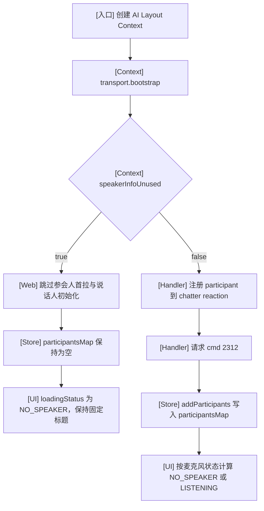

交付说明:目标分支为 master(当前 worktree 的分支从 origin/master 172bf82f0a83a29cc82a2fde6f03d88e38a655be 切出,MR 合回 master)。Meego:https://meego.larkoffice.com/larksuite/story/detail/7381590191。MR 类型 feature。

# 修复 vc-ai 移动端无效拉取参会人信息导致 APINotProvided 告警

## 0. 人工确认信息（2026-09-30）

## vc-ai 移动端按 speakerInfoUnused 跳过参会人首拉

### 来源材料

- Meego：暂无；当前仍处于 Slardar 告警讨论阶段，尚未派单。
- PRD：无，需求来自本话题的线上告警排查与方案讨论。
- Minutes / 会议纪要：当前飞书话题。
- 技术文档：`byteview-web-harness/docs/dev-guide/Lark 客户端协议与运行时仓库关系.md`。
- 接口与协议：`PULL_VIDEO_CHAT_IN_MEETING_INFO`（cmd `2312`）、`VideoChatInMeetingInfo`、Rust SDK 妙记录音入会协议。
- Figma：无 UI 改动，Figma 不适用。
- Slardar：[issue 9491f36c4f6de64beb6e43092758d87d](https://slardar.bytedance.net/node/web/js/detail?env=online&bid=vc_ai&lang=zh&start_time=1790651382&end_time=1790737782&site_type=web&region=cn&issue_id=9491f36c4f6de64beb6e43092758d87d&layout=normal&release=1.0.0.360)。

## 1. 背景与目标

### 背景

`AILayoutService.bootstrap` 当前会无条件调用 `videochat.PullVideoChatInMeetingInfo`，把响应中的 `participants` 写入 `UserStore.participantsMap$`。

- 豆包移动端不提供 cmd `2312`，请求产生 `APINotProvided`；近 24 小时未查到成功样本。
- 妙记移动端可以请求成功，但 Rust SDK 的妙记录音入会协议不包含 `microphone_status`，Android 实测返回 `UNKNOWN`。
- `UserStore.loadingStatus$` 只有在参会人同时满足 `ON_THE_CALL`、未静音、`microphoneStatus === NORMAL` 时才返回 `LISTENING`；否则返回 `NO_SPEAKER`。
- 豆包移动端和妙记移动端都已声明 `speakerInfoUnused: true`，并已跳过说话人、字幕人名等初始化，但参会人首拉遗漏在条件之外。

### 目标

- `speakerInfoUnused: true` 时不再请求 cmd `2312`。
- 消除豆包移动端 `APINotProvided` 告警。
- 妙记移动端保持现有产品表现：首个鱼骨图话题生成前固定展示“正在识别说话人和讨论内容…”，不进入聆听态轮播。
- 普通 VC、飞书 PC、豆包 PC 等需要 participant 信息的入口保持现状。
- 将参会人初始化职责从 `AILayoutService` 移到独立 handler，使初始化边界与已有 context 组装方式一致。

### 非目标

- 不修改 `loadingStatus$` 的判定规则。
- 不让妙记新增麦克风状态检测或上报能力。
- 不修改 cmd `2312`、Server PB、Rust PB、Native/JSBridge。
- 不修改鱼骨图标题文案、轮播节奏或 UI。
- 不用 `catch APINotProvided` 替代条件跳过；无消费场景应从源头不发请求。

## 2. 产品线与范围约束

- 产品线：`byteview-web/vc-ai`。
- 直接生效场景：豆包 Mobile、飞书 Minutes Mobile。
- 保持原行为：飞书 VC PC、飞书 VC Mobile、Minutes PC、豆包 PC，以及其他未传 `speakerInfoUnused: true` 的入口。
- 当前 `speakerInfoUnused: true` 仅用于 `doubao-ai-layout-mobile.tsx` 与 `minutes-ai-layout-mobile.tsx`。
- 两个移动端 transport 都覆盖父类 `bootstrap` 且不调用 `super.bootstrap`，不会注册普通 VC 的 `PARTICIPANTS_CHANGED` 订阅；因此跳过首拉后，`participantsMap$` 不会被另一条 participant push 回填。
- 兼容性：纯 Web 条件控制，无宿主版本门槛；旧线上包行为不变，新包生效。
- FG / Settings：不新增、不修改。
- 数据与权限：不新增数据采集，也不改变权限逻辑。

## 3. 需求规格化结果

### REQ-01：按入口能力决定是否首拉参会人

- 触发条件：创建 AI Layout context。
- 规则：`speakerInfoUnused !== true` 时执行一次 cmd `2312`；为 `true` 时完全不发请求。
- 验收：豆包 Mobile、Minutes Mobile 均无 cmd `2312`；其他入口仍调用一次。

### REQ-02：保持既有标题状态语义

- `speakerInfoUnused: true`：`participantsMap$` 不由首拉填充，`loadingStatus$` 保持 `NO_SPEAKER`，不进入“聆听中”轮播。
- 其他入口：成功拉到符合条件的 participant 后仍可进入 `LISTENING`。
- 验收：两个目标移动端入口视觉表现不变；普通 VC 聆听态不回归。

### REQ-03：职责拆分与回归保护

- 把“首拉参会人并写入 store”抽成独立 handler。
- `AILayoutService.bootstrap` 只保留 AI Layout 内容、FG、鱼骨图与事件相关初始化。
- 单测锁定开关、调用次数、写入结果及 `loadingStatus$` 的关键语义。

### 去噪与名词对齐

- 保留：豆包 `APINotProvided`、妙记 `UNKNOWN`、`participantsMap$ -> loadingStatus$ -> TitleChat` 产品链路。
- 去除：修复不扩展到 Rust/Server，因为本次目标是停止无效消费，不是补齐妙记设备状态。
- “参会人首拉”对应 `pullVideoChatInMeetingInfo({ id: meetingId })`。
- “聆听中”对应 `LoadingStatus.LISTENING`；“固定首条处理中标题”对应 `LoadingStatus.NO_SPEAKER`。
- “说话人信息未使用”对应 `speakerInfoUnused`，其语义需扩展为同时不初始化 participant 首拉与 speaker/chatter 能力。
- 待裁决项：无。

## 4. 接口与配置依赖

### Settings 与 FG

- 无新增或修改。

### Server 接口 / Server PB

- 存量接口：`videochat.PullVideoChatInMeetingInfo`。
- Command：`PULL_VIDEO_CHAT_IN_MEETING_INFO = 2312`。
- Request：`PullVideoChatInMeetingInfoRequest { id }`。
- Response：`VideoChatInMeetingInfo { participants }`。
- 本次不修改接口或 codec，只改变 Web 是否调用。

### Rust PB

- 不修改。Rust SDK 只作为方案证据。
- 妙记专用协议原文：

```proto
message SelfParticipantInfo {
    message ParticipantSettings {
        optional bool is_microphone_muted = 1; // 麦克风开/关
        optional bool is_camera_muted = 2; // 摄像头开/关
    }
    required ParticipantType participant_type = 1;
    optional ParticipantSettings participant_settings = 2;
}
```

- 妙记 Rust 入会实现只提交 `is_microphone_muted=false`、`is_camera_muted=true`，没有后续 `microphone_status` 更新路径。

### 宿主能力接口

- PC ShellAPI：无变化。
- Mobile JSBridge：无变化。
- 豆包 PC 容器接口：无变化。

## 5. 模块设计

### 模块：按 speakerInfoUnused 初始化参会人

#### Web 生效场景与归属

- 场景：`vc-ai` 全入口共享 context bootstrap；实际行为变化仅在豆包 Mobile 与 Minutes Mobile。
- 归属：Web。
- 原因：请求由 Web bootstrap 发起，且当前已有入口级 `speakerInfoUnused` 能力声明，无需下沉到 Native 或 Server。

#### 代码落点

- 新增 `vc-ai/src/handlers/setup-pull-video-chat-in-meeting-info.ts`
  - 接收 `IAILayoutContext`。
  - 读取 `appStore.meetingId`。
  - 调用 `transport.pullVideoChatInMeetingInfo({ id: meetingId })`。
  - 响应存在 `participants` 时，通过 `userStore.addParticipants(participants)` 写入。
  - 不针对 `APINotProvided` 做吞错降级；条件分支保证不支持的入口根本不调用，支持场景保留原有异常可观测性。

- 修改 `vc-ai/src/services/ai-layout.ts`
  - 从 `AILayoutService.bootstrap` 删除 cmd `2312` 请求与 `userStore.addParticipant` 循环。
  - 同步移除不再使用的 `userStore` 解构。
  - 其余初始化顺序保持不变。

- 修改 `vc-ai/src/utils/context/ai-layout-context.ts`
  - 引入新 handler。
  - 在 `if (!speakerInfoUnused)` 中按以下顺序调用：
    1. `setupParticipantsInitializeChatters(aiLayoutContext)`；
    2. `setupSubtitlesInitializeChatters(aiLayoutContext)`；
    3. `setupPullVideoChatInMeetingInfo(aiLayoutContext)`。
  - 先注册 reaction、后发起异步首拉，保证 participant 写入时 chatter 初始化能收到变化。
  - 更新 `speakerInfoUnused` 注释，明确其同时关闭 participant 首拉、说话人/字幕人名初始化，以及依赖 participant 麦克风状态的聆听态。

- 不修改以下文件的业务逻辑：
  - `vc-ai/src/doubao-ai-layout-mobile.tsx`：继续传 `speakerInfoUnused: true`。
  - `vc-ai/src/minutes-ai-layout-mobile.tsx`：继续传 `speakerInfoUnused: true`。
  - `vc-ai/src/stores/user.ts`：继续使用现有 `loadingStatus$` 判定。
  - 各 transport：接口保留，供正常 VC / PC 场景使用。

#### 核心流程



## 6. 测试方案

### 单元测试

- 新增 `vc-ai/src/handlers/setup-pull-video-chat-in-meeting-info.test.ts`：
  - 使用 meetingId 调用 `pullVideoChatInMeetingInfo` 一次。
  - `participants` 存在时调用 `userStore.addParticipants`。
  - `participants` 缺失或为空时不产生错误、不会写入无效数据。

- 修改 `vc-ai/src/utils/context/ai-layout-context.test.ts`：
  - mock 新 handler。
  - 豆包 Mobile + `speakerInfoUnused=true`：handler 调用次数为 0。
  - Minutes Mobile + `speakerInfoUnused=true`：handler 调用次数为 0。
  - VC Mobile 默认值：handler 调用一次。
  - Minutes PC 默认值：handler 调用一次。
  - 豆包 PC 默认值：handler 调用一次。
  - 保留现有 speaker/chatter handler 断言，避免条件调整破坏既有初始化。

- 新增或补充 `UserStore.loadingStatus$` 测试，锁定本次方案依赖的既有事实：
  - 空 participants -> `NO_SPEAKER`。
  - `microphoneStatus=UNKNOWN` -> `NO_SPEAKER`。
  - `ON_THE_CALL + 未静音 + NORMAL` -> `LISTENING`。

### 本地验证

```bash
pnpm --dir vc-ai test -- src/handlers/setup-pull-video-chat-in-meeting-info.test.ts src/utils/context/ai-layout-context.test.ts
pnpm --dir vc-ai typecheck
```

CI 再执行 `vc-ai` 完整单测与构建。

### 手工验收

- 豆包 Mobile：打开 AI 视图，无 cmd `2312` 请求、无 `APINotProvided`；鱼骨图正常；首个话题前保持固定处理中标题。
- Minutes Android：无 cmd `2312` 请求；鱼骨图正常；标题表现与改动前一致。
- Minutes iOS：同 Android，重点验证无请求且标题未回归。
- 飞书 VC Mobile / PC：仍有一次 cmd `2312`；返回正常 participant 时可进入 `LISTENING`。
- Minutes PC、豆包 PC：仍执行原首拉，不受移动端条件影响。

### 线上验收

- 新版本发布后按页面 `/webview/doubao-ai-layout-mobile` 观察 Slardar issue，不应再出现由该入口触发的 cmd `2312` `APINotProvided`。
- 同时观察鱼骨图拉取与渲染的既有成功日志，确认未因 bootstrap 重构出现新错误。
- 在 Minutes Mobile 日志中确认不再出现 `pullVideoChatInMeetingInfo start`，且鱼骨图主链路正常。

## 7. 风险与回滚

- 风险：未来某入口传入 `speakerInfoUnused: true`，却新增了 participant 数据消费。
  - 防护：扩展字段注释，并由 context 单测锁定该 flag 的完整语义；新增消费时必须取消该 flag 或引入独立数据源。
- 风险：未来妙记补齐 `microphone_status`，仍因当前 flag 不显示聆听态。
  - 处理：这是本次明确固化的产品语义；届时若要恢复聆听态，应先调整入口能力声明，再恢复 participant 数据源，而不是悄悄放开 2312。
- 风险：迁移 handler 改变初始化先后顺序。
  - 防护：保持同一 bootstrap tick 发起请求，并确保 reaction 注册在请求前。
- 回滚：回退本次 Web 提交，将首拉逻辑放回 `AILayoutService.bootstrap`；无配置、协议或数据迁移，回滚成本低。

## 8. 交付范围

- 代码：1 个新 handler，2 个现有文件调整。
- 测试：1 个 handler 测试文件、1 个 context 测试文件调整，建议补 1 个 UserStore 行为测试。
- 不涉及：Rust SDK 改动、PB 生成、Server/Native 联调、FG/Settings、i18n、UI/Figma。
- 当前不创建 Meego、managed task 或 MR；待方案确认并明确“派这条”后再进入实施流程。

如果以上边界确认且没有额外材料或约束，我再把方案落盘并进入实施。

以上是本任务的范围边界，与第 4 节修法冲突时以本节为准。用户已在当前 Slardar 排查话题明确批准“可以派单了”。

## 1. 线上事实（Slardar，bid=vc_ai，env=online，2026-09-29 11:09:42–2026-09-30 11:09:42 +0800）

- Issue `9491f36c4f6de64beb6e43092758d87d`，错误信息 `APINotProvided`，上报文件 `webpack://@byteview-web/vc-ai/../packages/vc-web-utils/gateway/request.ts`，扫描状态 `unassigned`、派单池状态 `pending`。
- Slardar 告警链接（评审看上下文用，MR 描述须原样带上）：https://slardar.bytedance.net/node/web/js/detail?env=online&bid=vc_ai&lang=zh&start_time=1790651382&end_time=1790737782&site_type=web&region=cn&issue_id=9491f36c4f6de64beb6e43092758d87d&layout=normal&release=1.0.0.360
- 24h 127678 次 / 72683 用户；首次出现 2026-09-29 11:09:42 +0800。
- 300 条事件抽样：页面 `/webview/doubao-ai-layout-mobile` 300；系统 iOS 300；release `1.0.0.360` 300；source_type `manual` 300；宿主版本 unknown 300；distinct session 300。
- 结论：样本全部来自豆包 AI Layout Mobile iOS。该入口不提供 cmd 2312，但共享 `AILayoutService.bootstrap` 无条件发起请求，形成稳定、高量的 `APINotProvided` 告警。

## 2. 线上代码（1.0.0.360 = SCM ee/lark/vc_ai_doubao，master，commit 81e22c28d06eb68ff6cdccac9603c400a302d6ff）

- `vc-ai/src/services/ai-layout.ts:176` `AILayoutService.bootstrap`：无条件调用 `pullVideoChatInMeetingInfo({ id: appStore.meetingId })`，成功后把 participants 写入 `userStore`。
- 该 commit 只用于说明线上事件对应的代码形态；所有改动都在 master 上做。

## 3. master 现状（172bf82f0a83a29cc82a2fde6f03d88e38a655be，本任务改动基线）

- `vc-ai/src/services/ai-layout.ts:148`：`AILayoutService.bootstrap` 承担了与入口能力无关的参会人首拉，并在 176–186 行无条件发起 cmd 2312。
- `vc-ai/src/utils/context/ai-layout-context.ts:114`：`speakerInfoUnused` 只包围 chatter 初始化，尚未包围参会人首拉。
- `vc-ai/src/stores/user.ts:90`：`loadingStatus$` 读取 `participantsMap$`，仅在 `ON_THE_CALL + 未静音 + microphoneStatus=NORMAL` 时返回 `LISTENING`，否则为 `NO_SPEAKER`。
- 既有测试载体：`vc-ai/src/utils/context/ai-layout-context.test.ts`；新增 handler 测试按同目录 handler 测试写法。单测命令 `cd vc-ai && pnpm test src/handlers/setup-pull-video-chat-in-meeting-info.test.ts src/utils/context/ai-layout-context.test.ts`；impl 停止钩子实跑 `pnpm run typecheck && pnpm run test && pnpm --if-present --parallel run test-storybook`。

## 4. 根因与修法

触发器：每次目标移动端入口创建 AI Layout context 时，无条件启动一次参会人首拉。Slardar 300 条抽样全部落在豆包 Mobile iOS，说明不是竞态或重复订阅，而是入口能力与共享 bootstrap 行为不匹配。

修法（最小抑制）：

1. 新增 `vc-ai/src/handlers/setup-pull-video-chat-in-meeting-info.ts`，封装 meetingId 读取、cmd 2312 请求和 participants 写入。
2. 从 `AILayoutService.bootstrap` 移除参会人首拉及对应 `userStore` 依赖；不吞掉支持场景中的请求异常。
3. 在 `bootstrapBaseAILayoutContext` 的 `if (!speakerInfoUnused)` 中，先注册 participant/subtitle 到 chatter 的 reaction，再调用新 handler。
4. 扩展 `speakerInfoUnused` 注释，明确其关闭 participant 首拉、speaker/chatter 初始化及依赖 participant 麦克风状态的聆听态。
5. 不修改两个目标移动端入口的 flag；不修改 Rust SDK、PB、Server、Native、FG、Settings、i18n 或 UI。

## 5. 验收标准

- AC1 首条红灯测试必须复现缺陷。复现步骤：以 `speakerInfoUnused=true` 创建豆包 Mobile 或 Minutes Mobile 的 AI Layout context；改动前实际表现：仍调用 `pullVideoChatInMeetingInfo` 一次，豆包入口产生 `APINotProvided`；期望表现：handler 调用次数为 0、cmd 2312 不发出，标题状态仍为 `NO_SPEAKER`。红灯失败摘要必须能对上该额外调用。
- AC2 `speakerInfoUnused=false` 或缺省的 VC Mobile / PC、Minutes PC、豆包 PC 仍调用一次 cmd 2312；participants 存在时写入 store，并能维持既有 `LISTENING` 能力。
- AC3 handler 单测覆盖 meetingId 入参、participants 成功写入及空响应；context 单测覆盖 flag 两侧调用次数；必要时补充 `loadingStatus$` 对空 participants、UNKNOWN、NORMAL 的现有语义测试。
- AC4 通过聚焦单测 `pnpm --dir vc-ai test -- src/handlers/setup-pull-video-chat-in-meeting-info.test.ts src/utils/context/ai-layout-context.test.ts` 与 `pnpm --dir vc-ai typecheck`，CI 再执行 vc-ai 完整单测与构建。
- AC5 范围：只改上述 Web 文件与对应测试；不改 native 协议；不新增 i18n。

## 6. 范围外（如实上报，不在本 MR 处理）

- 不补齐妙记 `microphone_status`，不改变 `loadingStatus$` 或标题 UI。
- 不改 cmd 2312、Server/Rust PB、Native/JSBridge、FG、Settings。
- 不处理其他 Slardar issue，也不把支持场景的错误改为静默 catch。
